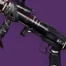
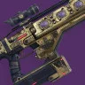
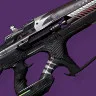
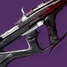
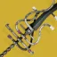
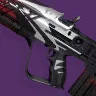
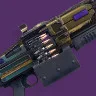

# 二象性

描述：二象性地牢信息集合——首领生命值、输出时间、人均 DPS 门槛与关卡武器护甲掉落。
更新：2026.11.16
路径：raid-guides/duality
上级：Raid & 地牢
页脚：首领数值为固定难度下的实测值，不随光等浮动。
数据源：[Destiny 2: Boss Damage](https://docs.google.com/spreadsheets/u/0/d/1_5wtBjRYHHxuF4oJKDb_iOGZs-wTkzB6RYbnyNLbuz4/htmlview#gid=1346678363) 与 LFCarry 的 [Dungeon Loot Tables](https://lfcarry.com/guides/destiny-2-dungeon-loot-tables)
鸣谢：小黑盒用户{buff|“压力一直天满光”}校对首领名称，蜃零#7456 整理{exotic|异域}武器与催化剂获取。
版式：副本
首屏图标：4

## 首领数值

色阶：生命值 36000 105000 112295 140000 165000 210000 250000

| 首领名称 | 生命值 | 距离 | 时间 | 击杀 DPS | 一波 DPS | 注解 |
|---|---|---|---|---|---|---|
|  加尔兰梦魇 | 133133 | 近 | 60 | 247 | 740 | {buff|不稳定精华}提供 {amp|50% 额外伤害} |
|  保险库 | 21905 | 近 |  |  |  | {health|生命值}不含元素护盾 |
|  查厄托梦魇 | 117486 | 近 | 12 | 363 | 3264 | 未持有{buff|苏醒共鸣}时{res|90% 减伤}、{amp|精准倍率 ×1.5} |

## 关卡掉落

护甲套装：深渊探索者（各关卡均有掉落）；{exotic|异域}武器：{exotic|心影}（尾王掉落，催化剂由解密获取）。

| 关卡 | 武器掉落 | 护甲部位 |
|---|---|---|
| 第 1 关 · 加尔兰梦魇 |  {el-stasis|冰影} · 不散恐惧（榴弹发射器）\\ {el-void|虚空} · 享乐主义（融合步枪） |      任意部位 |
| 第 2 关 · 保险库 |  {el-arc|电弧} · 风暴猎人（线性融合步枪）\\ {el-void|虚空} · 不可饶恕（微型冲锋枪） |      任意部位 |
| 第 3 关 · 查厄托梦魇（双倍掉落） |  {exotic|心影}（{el-void|虚空} 刀剑）\\ {el-stasis|冰影} · 新目标（脉冲步枪）\\ {el-solar|烈日} · 宿命（机枪）\\其余任意地牢武器 |      任意部位 |

{note|宿命（尾王）与享乐主义（尾王、第一位首领）也可锻造但掉率较低。}
