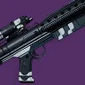
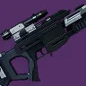
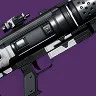
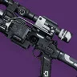
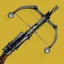
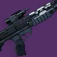
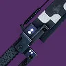

# 平衡

描述：平衡地牢信息集合——首领生命值、输出时间、人均 DPS 门槛与关卡武器护甲掉落。
更新：2026.11.16
路径：raid-guides/equilibrium
上级：Raid & 地牢
页脚：首领数值为固定难度实测，不随光等浮动；击杀 / 一波 DPS 为满编人均门槛（突袭 6 人、地牢 3 人）。
数据源：[Destiny 2: Boss Damage](https://docs.google.com/spreadsheets/u/0/d/1_5wtBjRYHHxuF4oJKDb_iOGZs-wTkzB6RYbnyNLbuz4/htmlview#gid=1346678363) 与 LFCarry 的 [Dungeon Loot Tables](https://lfcarry.com/guides/destiny-2-dungeon-loot-tables)
鸣谢：小黑盒用户{buff|“压力一直天满光”}校对首领名称，蜃零#7456 整理{exotic|异域}武器与催化剂来源
版式：副本
首屏图标：3

## 首领数值

色阶：生命值 36000 105000 112295 140000 165000 210000 250000

| 首领名称 | 生命值 | 距离 | 时间（秒） | 击杀 DPS | 一波 DPS | 注解 |
|---|---|---|---|---|---|---|
|  德瑞捷学徒哈罗 | 206963 | 近 | 33.167 | 693 | 2080 |  |
|  德瑞捷·赛尔 | 143884 | 近至中 | 37.45 | 427 | 1281 |  |

## 关卡掉落

护甲套装：圣贤保护者；{exotic|异域}武器：{exotic|传家宝}（尾王掉落，催化剂由任务同调获取）。

| 关卡 | 武器掉落 | 护甲部位 |
|---|---|---|
| 第 1 关 · 收割者 |  {el-solar|烈日} · 狂热理想（自动步枪）\\ {el-arc|电弧} · 伏打阴影（斥候步枪） |    腿部\\   手臂\\   胸部 |
| 第 2 关 · 德瑞捷学徒哈罗 |  {el-arc|电弧} · 痛苦结局（机枪）\\ {el-arc|电弧} · 伏打阴影（斥候步枪）\\ {el-stasis|冰影} · 阴谋淬砺（狙击步枪） |    职业物品\\   手臂\\   头部 |
| 第 3 关 · 德瑞捷·赛尔 |  {exotic|传家宝}（{el-solar|烈日} 战斗弓箭）\\ {el-void|虚空} · 高阶暴君（脉冲步枪）\\ {el-void|虚空} · 阴沉利爪（刀剑）\\其余任意地牢武器 |    职业物品\\   腿部 |
