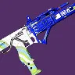
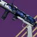
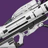
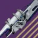
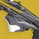

# 深渊机灵

描述：深渊机灵地牢信息集合——首领生命值、输出时间、人均 DPS 门槛与关卡武器护甲掉落。
更新：2026.11.16
路径：raid-guides/ghosts-of-the-deep
上级：Raid & 地牢
页脚：首领数值为固定难度实测，不随光等浮动；击杀 / 一波 DPS 为满编人均门槛（突袭 6 人、地牢 3 人）。
数据源：[Destiny 2: Boss Damage](https://docs.google.com/spreadsheets/u/0/d/1_5wtBjRYHHxuF4oJKDb_iOGZs-wTkzB6RYbnyNLbuz4/htmlview#gid=1346678363) 与 LFCarry 的 [Dungeon Loot Tables](https://lfcarry.com/guides/destiny-2-dungeon-loot-tables)
鸣谢：小黑盒用户{buff|“压力一直天满光”}校对首领名称，蜃零#7456 整理{exotic|异域}武器与催化剂来源
版式：副本
首屏图标：3

## 首领数值

色阶：生命值 36000 105000 112295 140000 165000 210000 250000

| 首领名称 | 生命值 | 距离 | 时间（秒） | 击杀 DPS | 一波 DPS | 注解 |
|---|---|---|---|---|---|---|
|  艾克塔 | 180621 | 近至中 | 40 | 502 | 1505 | {health|生命值}不含 约 10800 白色护盾 |
|  厄诺克鲁 | 144404 | 远 | 45 | 357 | 1070 | {health|生命值}不含 约 10800 白色护盾 |

## 关卡掉落

护甲套装：傀儡邪神；{exotic|异域}武器：{exotic|领航员}（尾王掉落，催化剂由解密获取）。

| 关卡 | 武器掉落 | 护甲部位 |
|---|---|---|
| 第 1 关 · 邪魔族仪式 |  {el-solar|烈日} · 无人幸存（微型冲锋枪）\\ {el-stasis|冰影} · 新太平洋碑文（榴弹发射器）\\ {el-stasis|冰影} · 无效安慰（火箭发射器） |    手臂\\   腿部\\   头部 |
| 第 2 关 · 艾克塔 |  {el-solar|烈日} · 无人幸存（微型冲锋枪）\\ {el-solar|烈日} · 滑溜运气（偃月）\\ {el-stasis|冰影} · 无效安慰（火箭发射器） |    手臂\\   胸部\\   职业物品 |
| 第 3 关 · 厄诺克鲁 |  {exotic|领航员}（{el-strand|缚丝} 追踪步枪）\\其余任意地牢武器 |      任意部位 |
