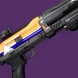
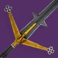
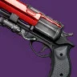
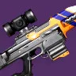
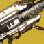

# 贪婪之握

描述：贪婪之握地牢信息集合——首领生命值、输出时间、人均 DPS 门槛与关卡武器护甲掉落。
更新：2026.11.16
路径：raid-guides/grasp-of-avarice
上级：Raid & 地牢
页脚：首领数值为固定难度下的实测值，不随光等浮动。
数据源：[Destiny 2: Boss Damage](https://docs.google.com/spreadsheets/u/0/d/1_5wtBjRYHHxuF4oJKDb_iOGZs-wTkzB6RYbnyNLbuz4/htmlview#gid=1346678363) 与 LFCarry 的 [Dungeon Loot Tables](https://lfcarry.com/guides/destiny-2-dungeon-loot-tables)
鸣谢：小黑盒用户{buff|“压力一直天满光”}校对首领名称，蜃零#7456 整理{exotic|异域}武器与催化剂获取。
版式：副本
首屏图标：3

## 首领数值

色阶：生命值 36000 105000 112295 140000 165000 210000 250000

| 首领名称 | 生命值 | 距离 | 时间 | 击杀 DPS | 一波 DPS | 注解 |
|---|---|---|---|---|---|---|
|  弗里吉亚 | 101053 | 近至中 | 30 | 374 | 1123 |  |
|  阿瓦罗克斯 | 111700 | 中 | 28 | 443 | 1330 |  |

## 关卡掉落

护甲套装：渴望回响；{exotic|异域}武器：{exotic|加拉尔号角}（解密获取，催化剂同为解密获取）。

| 关卡 | 武器掉落 | 护甲部位 |
|---|---|---|
| 第 1 关 · 弗里吉亚 |  {el-arc|电弧} · 斗牛士 64（霰弹枪）\\ {el-arc|电弧} · 永世英雄（刀剑） |    腿部\\   职业物品 |
| 第 2 关 · 堕落者护盾 |  {el-arc|电弧} · 斗牛士 64（霰弹枪）\\ {el-arc|电弧} · 永世英雄（刀剑） |    胸部\\   手臂 |
| 第 3 关 · 阿瓦罗克斯 |  {el-arc|电弧} · 斗牛士 64（霰弹枪）\\ {el-arc|电弧} · 永世英雄（刀剑）\\ {el-stasis|冰影} · 鹰月（手炮）\\ {el-void|虚空} · 千码凝视（狙击步枪） |    头部\\   手臂\\   腿部\\   职业物品 |
| 异域任务（And Out Fly the Wolves） |  {exotic|加拉尔号角}（{el-solar|烈日} 火箭发射器） | 无 |
