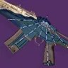
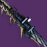
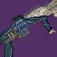
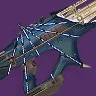
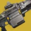

# 异端深渊

描述：异端深渊地牢信息集合——首领生命值、输出时间、人均 DPS 门槛与关卡武器护甲掉落。
更新：2026.11.16
路径：raid-guides/pit-of-heresy
上级：Raid & 地牢
页脚：首领数值为固定难度下的实测值，不随光等浮动。
数据源：[Destiny 2: Boss Damage](https://docs.google.com/spreadsheets/u/0/d/1_5wtBjRYHHxuF4oJKDb_iOGZs-wTkzB6RYbnyNLbuz4/htmlview#gid=1346678363) 与 LFCarry 的 [Dungeon Loot Tables](https://lfcarry.com/guides/destiny-2-dungeon-loot-tables)
鸣谢：小黑盒用户{buff|“压力一直天满光”}校对首领名称，蜃零#7456 整理{exotic|异域}武器与催化剂获取。
版式：副本
首屏图标：2

## 首领数值

色阶：生命值 36000 105000 112295 140000 165000 210000 250000

| 首领名称 | 生命值 | 距离 | 时间 | 击杀 DPS | 一波 DPS | 注解 |
|---|---|---|---|---|---|---|
|  祖尔马克 | 61752 | 近 | 50 | 137 | 412 |  |

## 关卡掉落

护甲套装：变节者利刃；{exotic|异域}武器：{exotic|异星噬菌}（解密获取，催化剂由尾王掉落）。

| 关卡 | 武器掉落 | 护甲部位 |
|---|---|---|
| 全部关卡 |  {el-strand|缚丝} · 金刚磐石（自动步枪）\\ {el-strand|缚丝} · 拒绝召唤（偃月）\\ {el-arc|电弧} · 送魂者（榴弹发射器）\\ {el-void|虚空} · 揭纱露眼（线性融合步枪） |      任意部位 |
| 异域任务（The Journey） |  {exotic|异星噬菌}（{el-solar|烈日} 机枪） | 无 |
