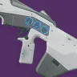
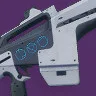
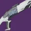
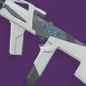
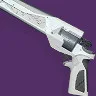
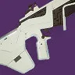

# 预言

描述：预言地牢信息集合——首领生命值、输出时间、人均 DPS 门槛与关卡武器护甲掉落。
更新：2026.11.16
路径：raid-guides/prophecy
上级：Raid & 地牢
页脚：首领数值为固定难度实测，不随光等浮动。
数据源：[Destiny 2: Boss Damage](https://docs.google.com/spreadsheets/u/0/d/1_5wtBjRYHHxuF4oJKDb_iOGZs-wTkzB6RYbnyNLbuz4/htmlview#gid=1346678363) 与 LFCarry 的 [Dungeon Loot Tables](https://lfcarry.com/guides/destiny-2-dungeon-loot-tables)
鸣谢：小黑盒用户{buff|“压力一直天满光”}校对首领名称
版式：副本
首屏图标：3

## 首领数值

色阶：生命值 36000 105000 112295 140000 165000 210000 250000

| 首领名称 | 生命值 | 距离 | 时间 | 击杀 DPS | 一波 DPS | 注解 |
|---|---|---|---|---|---|---|
|  方阵士兵 | 49678 | 近 | 50 | 110 | 331 |  |
|  凯尔回响 | 105803 | 远 | 105 | 112 | 336 | 团灭结算界面显示的伤害{note|为实际的 2 倍} |

## 关卡掉落

护甲套装：终曲；无专属{exotic|异域}武器。

| 关卡 | 武器掉落 | 护甲部位 |
|---|---|---|
| 第 1 关 · 方阵士兵 |  {el-strand|缚丝} · 无情（脉冲步枪）\\ {el-arc|电弧} · 检察官（自动步枪） |    腿部\\   职业物品 |
| 第 2 关 · 立方体 |  {el-void|虚空} · 猝死（霰弹枪）\\ {el-kinetic|动能} · 判决（微型冲锋枪） |    手臂 |
| 第 3 关 · 凯尔回响 | 仅掉落护甲 |    头部\\   手臂\\   胸部\\   腿部\\   职业物品 |
| 通关终局宝箱 |  {el-stasis|冰影} · 审判（手炮）\\ {el-solar|烈日} · 黑暗极致（脉冲步枪） |    头部\\   胸部\\   职业物品 |
