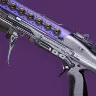
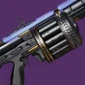
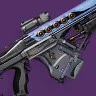
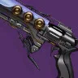
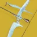

# 破碎王座

描述：破碎王座地牢信息集合——首领生命值、输出时间、人均 DPS 门槛与关卡武器护甲掉落。
更新：2026.11.16
路径：raid-guides/shattered-throne
上级：Raid & 地牢
页脚：首领数值为固定难度下的实测值，不随光等浮动。
数据源：[Destiny 2: Boss Damage](https://docs.google.com/spreadsheets/u/0/d/1_5wtBjRYHHxuF4oJKDb_iOGZs-wTkzB6RYbnyNLbuz4/htmlview#gid=1346678363) 与 LFCarry 的 [Dungeon Loot Tables](https://lfcarry.com/guides/destiny-2-dungeon-loot-tables)
鸣谢：小黑盒用户{buff|“压力一直天满光”}校对首领名称，蜃零#7456 整理{exotic|异域}武器与催化剂获取。
版式：副本
首屏图标：3

## 首领数值

色阶：生命值 36000 105000 112295 140000 165000 210000 250000

| 首领名称 | 生命值 | 距离 | 时间 | 击杀 DPS | 一波 DPS | 注解 |
|---|---|---|---|---|---|---|
|  沃戈斯 | 23163 | 近 | 30 | 86 | 257 |  |
|  杜兰卡鲁 | 214959 | 近 | 45 | 531 | 1592 | 视为{bar-orange|橙血} |

## 关卡掉落

护甲套装：灵巫华服；{exotic|异域}武器：{exotic|碎愿者}（解密获取，催化剂由尾王掉落）。

| 关卡 | 武器掉落 | 护甲部位 |
|---|---|---|
| 全部关卡 |  {el-stasis|冰影} · 碎晶石（霰弹枪）\\ {el-solar|烈日} · 大犬座（榴弹发射器）\\ {el-arc|电弧} · 光鳃之调（自动步枪）\\ {el-stasis|冰影} · 星狐座（手炮） |      任意部位 |
| 地牢异域任务 |  {exotic|碎愿者}（{el-kinetic|动能} 战斗弓箭） | 无 |
