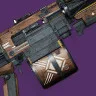
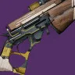
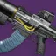
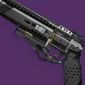
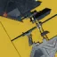
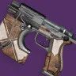
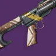

# 守望者尖塔

描述：守望者尖塔地牢信息集合——首领生命值、输出时间、人均 DPS 门槛与关卡武器护甲掉落。
更新：2026.11.16
路径：raid-guides/spire-of-the-watcher
上级：Raid & 地牢
页脚：首领数值为固定难度实测，不随光等浮动；击杀 / 一波 DPS 为满编人均门槛（突袭 6 人、地牢 3 人）。
数据源：[Destiny 2: Boss Damage](https://docs.google.com/spreadsheets/u/0/d/1_5wtBjRYHHxuF4oJKDb_iOGZs-wTkzB6RYbnyNLbuz4/htmlview#gid=1346678363) 与 LFCarry 的 [Dungeon Loot Tables](https://lfcarry.com/guides/destiny-2-dungeon-loot-tables)
鸣谢：小黑盒用户{buff|“压力一直天满光”}校对首领名称，蜃零#7456 整理{exotic|异域}武器与催化剂来源
版式：副本
首屏图标：3

## 首领数值

色阶：生命值 36000 105000 112295 140000 165000 210000 250000

| 首领名称 | 生命值 | 距离 | 时间（秒） | 击杀 DPS | 一波 DPS | 注解 |
|---|---|---|---|---|---|---|
|  阿克勒斯 | 112294 | 近至中 | 27.817 | 449 | 1346 |  |
|  珀塞斯 | 148907 | 近至中 | 22.967 | 720 | 2161 |  |

## 关卡掉落

护甲套装：定制特机；{exotic|异域}武器：{exotic|需求层级}（尾王掉落，催化剂由大师难度掉落）。

| 关卡 | 武器掉落 | 护甲部位 |
|---|---|---|
| 第 1 关 · 尖塔攀升 |  {el-arc|电弧} · 终点视界（机枪）\\ {el-arc|电弧} · 长臂（斥候步枪）\\ {el-kinetic|动能} · 第七炽天使卡宾枪（自动步枪） |    手臂\\   腿部\\   头部 |
| 第 2 关 · 阿克勒斯 |  {el-arc|电弧} · 终点视界（机枪）\\ {el-kinetic|动能} · 第七炽天使军官左轮（手炮） |    手臂\\   胸部\\   职业物品 |
| 第 3 关 · 珀塞斯 |  {exotic|需求层级}（{el-solar|烈日} 战斗弓箭）\\ {el-stasis|冰影} · 阈限守夜（手枪）\\ {el-void|虚空} · 狂野飞禽（榴弹发射器）\\其余任意地牢武器 |      任意部位 |
