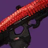
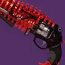
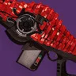
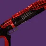

# 分离教义

描述：分离教义地牢信息集合——首领生命值、输出时间、人均 DPS 门槛与关卡武器护甲掉落。
更新：2026.11.16
路径：raid-guides/sundered-doctrine
上级：Raid & 地牢
页脚：首领数值为固定难度下的实测值，不随光等浮动。
数据源：[Destiny 2: Boss Damage](https://docs.google.com/spreadsheets/u/0/d/1_5wtBjRYHHxuF4oJKDb_iOGZs-wTkzB6RYbnyNLbuz4/htmlview#gid=1346678363) 与 LFCarry 的 [Dungeon Loot Tables](https://lfcarry.com/guides/destiny-2-dungeon-loot-tables)
鸣谢：小黑盒用户{buff|“压力一直天满光”}校对首领名称，蜃零#7456 整理{exotic|异域}武器与催化剂获取。
版式：副本
首屏图标：3

## 首领数值

色阶：生命值 36000 105000 112295 140000 165000 210000 250000

| 首领名称 | 生命值 | 距离 | 时间 | 击杀 DPS | 一波 DPS | 注解 |
|---|---|---|---|---|---|---|
|  生命锁具 | 205547 | 远 | 81.567 | 280 | 840 | {res|假本体首领}{note|（精准伤害、激涌、大部分易伤、部分武器 perk 与 buff 不生效）} |
|  被抹去者·克瑞夫 | 296370 | 近至中 | 45.2 | 729 | 2186 |  |

## 关卡掉落

护甲套装：剥露者；{exotic|异域}武器：{exotic|终局螺旋钻}（尾王掉落，催化剂由溺水迷宫获取）。

| 关卡 | 武器掉落 | 护甲部位 |
|---|---|---|
| 第 1 关（Solve the Riddle） |  {el-arc|电弧} · 无视（斥候步枪）\\ {el-strand|缚丝} · 无爱（手炮）\\ {el-strand|缚丝} · 无誓（追踪步枪） |    腿部\\   手臂\\   头部 |
| 第 2 关 · 生命锁具 |  {el-arc|电弧} · 无视（斥候步枪）\\ {el-void|虚空} · 无声（霰弹枪）\\ {el-strand|缚丝} · 无誓（追踪步枪） |    腿部\\   手臂\\   头部 |
| 第 3 关 · 被抹去者·克瑞夫 |  {exotic|终局螺旋钻}（{el-solar|烈日} 线性融合步枪）\\ {el-void|虚空} · 无声（霰弹枪）\\ {el-strand|缚丝} · 无誓（追踪步枪）\\ {el-arc|电弧} · 无视（斥候步枪） |    腿部\\   手臂\\   头部\\   胸部 |
