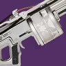
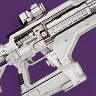
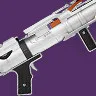
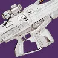
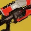

# 晚星之主

描述：晚星之主地牢信息集合——首领生命值、输出时间、人均 DPS 门槛与关卡武器护甲掉落。
更新：2026.11.16
路径：raid-guides/vespers-host
上级：Raid & 地牢
页脚：首领数值为固定难度实测，不随光等浮动；击杀 / 一波 DPS 为满编人均门槛（突袭 6 人、地牢 3 人）。
数据源：[Destiny 2: Boss Damage](https://docs.google.com/spreadsheets/u/0/d/1_5wtBjRYHHxuF4oJKDb_iOGZs-wTkzB6RYbnyNLbuz4/htmlview#gid=1346678363) 与 LFCarry 的 [Dungeon Loot Tables](https://lfcarry.com/guides/destiny-2-dungeon-loot-tables)
鸣谢：小黑盒用户{buff|“压力一直天满光”}校对首领名称，蜃零#7456 整理{exotic|异域}武器与催化剂来源
版式：副本
首屏图标：3

## 首领数值

色阶：生命值 36000 105000 112295 140000 165000 210000 250000

| 首领名称 | 生命值 | 距离 | 时间（秒） | 击杀 DPS | 一波 DPS | 注解 |
|---|---|---|---|---|---|---|
|  雷尼克斯联合 | 224291 | 近 | 15 | 791 | 2373 | {res|全局约 65% 减伤}、{note|分体各自结算，但不是假本体首领} |
|  腐化傀儡师 | 325278 | 中至远 | 95 | 380 | 1141 |  |

## 关卡掉落

护甲套装：太空漫步；{exotic|异域}武器：{exotic|破冰者}（尾王掉落，催化剂由「异常网络」任务获取）。

| 关卡 | 武器掉落 | 护甲部位 |
|---|---|---|
| 第 1 关 · 晚星空间站 |  {el-stasis|冰影} · VS 寒冷抑制（榴弹发射器）\\ {el-void|虚空} · VS 重力滞止（融合步枪）\\ {el-void|虚空} · VS 速度指挥（榴弹发射器） |    胸部\\   手臂\\   腿部 |
| 第 2 关 · 雷尼克斯联合 |  {el-stasis|冰影} · VS 寒冷抑制（榴弹发射器）\\ {el-void|虚空} · VS 重力滞止（融合步枪）\\ {el-arc|电弧} · VS 热电推进（自动步枪） |    头部\\   手臂\\   腿部 |
| 第 3 关 · 腐化傀儡师 |  {exotic|破冰者}（{el-solar|烈日} 狙击步枪）\\ {el-void|虚空} · VS 重力滞止（融合步枪）\\ {el-arc|电弧} · VS 热电推进（自动步枪）\\ {el-void|虚空} · VS 速度指挥（榴弹发射器） |    胸部\\   职业物品\\   腿部 |
