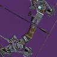
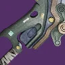
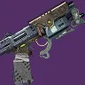
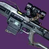
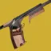

# 战争领主的废墟

描述：战争领主的废墟地牢信息集合——首领生命值、输出时间、人均 DPS 门槛与关卡武器护甲掉落。
更新：2026.11.16
路径：raid-guides/warlords-ruin
上级：Raid & 地牢
页脚：首领数值为固定难度下的实测值，不随光等浮动。
数据源：[Destiny 2: Boss Damage](https://docs.google.com/spreadsheets/u/0/d/1_5wtBjRYHHxuF4oJKDb_iOGZs-wTkzB6RYbnyNLbuz4/htmlview#gid=1346678363) 与 LFCarry 的 [Dungeon Loot Tables](https://lfcarry.com/guides/destiny-2-dungeon-loot-tables)
鸣谢：小黑盒用户{buff|“压力一直天满光”}校对首领名称，蜃零#7456 整理{exotic|异域}武器与催化剂获取。
版式：副本
首屏图标：4

## 首领数值

色阶：生命值 36000 105000 112295 140000 165000 210000 250000

| 首领名称 | 生命值 | 距离 | 时间 | 击杀 DPS | 一波 DPS | 注解 |
|---|---|---|---|---|---|---|
|  拉席尔 | 112393 | 近 | 20 | 624 | 1873 |  |
|  哀嚎之地 | 239073 | 近至中 | 15 | 443 | 5313 |  |
|  赫芬德 | 254999 | 中 | 20 | 472 | 4250 |  |

## 关卡掉落

护甲套装：黑暗纪元；{exotic|异域}武器：{exotic|深埋血脉}（尾王掉落，催化剂由群山阴影获取）。

| 关卡 | 武器掉落 | 护甲部位 |
|---|---|---|
| 第 1 关 · 拉席尔 |  {el-strand|缚丝} · 复仇低语（战斗弓箭）\\ {el-strand|缚丝} · 拜龙教镰刀（刀剑）\\ {el-arc|电弧} · 蒙恩（手枪） |    头部\\   手臂\\   腿部 |
| 第 2 关 · 哀嚎之地 |  {el-strand|缚丝} · 复仇低语（战斗弓箭）\\ {el-strand|缚丝} · 纳伊姆的长矛（狙击步枪）\\ {el-arc|电弧} · 蒙恩（手枪） |    手臂\\   胸部\\   职业物品 |
| 第 3 关 · 赫芬德 |  {exotic|深埋血脉}（{el-void|虚空} 手枪）\\ {el-strand|缚丝} · 纳伊姆的长矛（狙击步枪）\\ {el-arc|电弧} · 蒙恩（手枪）\\ {el-strand|缚丝} · 拜龙教镰刀（刀剑） |    头部\\   手臂\\   胸部\\   腿部 |
