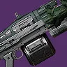
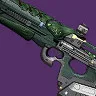
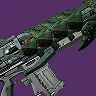
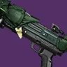
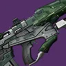
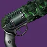
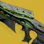

# 克洛塔的末日

描述：克洛塔的末日副本信息集合——图文攻略、首领生命值、DPS 门槛与关卡武器护甲掉落。
更新：2026.11.16
路径：raid-guides/crotas-end
上级：Raid & 地牢
页脚：首领数值为固定难度实测，不随光等浮动。
数据源：[Destiny 2: Boss Damage](https://docs.google.com/spreadsheets/u/0/d/1_5wtBjRYHHxuF4oJKDb_iOGZs-wTkzB6RYbnyNLbuz4/htmlview#gid=1346678363) 与 LFCarry 的 [Raid Loot Tables](https://lfcarry.com/guides/destiny-2-raid-loot-tables)
鸣谢：[遗忘Melt](https://space.bilibili.com/3706960595650983) 编写图文攻略，小黑盒用户{buff|“压力一直天满光”}校对首领名称，蜃零#7456 整理{exotic|异域}武器与红框来源
版式：副本
首屏图标：3

## 相关攻略

- [在腾讯文档查看「克洛塔的末日」图文攻略](https://docs.qq.com/doc/DQ0x6b3FXcnp1TGtP) | 图文攻略 · 腾讯文档 | 遗忘Melt 编写并维护

## 首领数值

色阶：生命值 170000 250155 290000 400000 500000 550000 868186

| 首领名称 | 生命值 | 距离 | 时间 | 击杀 DPS | 一波 DPS | 注解 |
|---|---|---|---|---|---|---|
|  死亡歌者·伊尔·约特 | 288027 | 近至中 | 45 | 356 | 1067 |  |
|  欧里克斯之子·克洛塔 | 480445 | 近至中 | 30 | 890 | 2669 | {amp|受到 135% 刀剑伤害} |

## 关卡掉落

护甲套装：克洛塔记忆；{exotic|异域}武器：{exotic|坏疽}（解密获取，催化剂同为解密获取）；六把传说武器均可获取红框锻造。

| 关卡 | 武器掉落 | 护甲部位 |
|---|---|---|
| 第 1 关 · 深入深渊 |  {el-arc|电弧} · 伊尔·约特之歌（机枪）\\ {el-strand|缚丝} · 伊尔·约特的尖牙（斥候步枪）\\ {el-solar|烈日} · 深渊叛逆（自动步枪） |    胸部\\   手臂\\   头部 |
| 第 2 关 · 跨越桥梁 |  {el-strand|缚丝} · 断剑者（霰弹枪）\\ {el-strand|缚丝} · 伊尔·约特的尖牙（斥候步枪）\\ {el-arc|电弧} · 超灵之诏（脉冲步枪） |    胸部\\   手臂\\   腿部 |
| 第 3 关 · 死亡歌者·伊尔·约特 |  {el-void|虚空} · 克洛塔之语（手炮）\\ {el-arc|电弧} · 伊尔·约特之歌（机枪）\\ {el-arc|电弧} · 超灵之诏（脉冲步枪） |    胸部\\   职业物品\\   腿部 |
| 第 4 关 · 欧里克斯之子·克洛塔 |  {el-void|虚空} · 克洛塔之语（手炮）\\ {el-solar|烈日} · 深渊叛逆（自动步枪）\\ {el-strand|缚丝} · 断剑者（霰弹枪） |    头部\\   职业物品\\   腿部 |
| 异域任务（Bottomless Pit） |  {exotic|坏疽}（{el-kinetic|动能} 自动步枪） | 无 |
