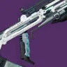
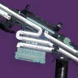
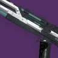
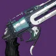
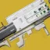
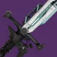
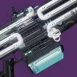

# 深岩墓室

描述：深岩墓室副本信息集合——图文攻略、首领生命值、DPS 门槛与关卡武器护甲掉落。
更新：2026.11.16
路径：raid-guides/deep-stone-crypt
上级：Raid & 地牢
页脚：首领数值为固定难度实测，不随光等浮动。
数据源：[Destiny 2: Boss Damage](https://docs.google.com/spreadsheets/u/0/d/1_5wtBjRYHHxuF4oJKDb_iOGZs-wTkzB6RYbnyNLbuz4/htmlview#gid=1346678363) 与 LFCarry 的 [Raid Loot Tables](https://lfcarry.com/guides/destiny-2-raid-loot-tables)
鸣谢：[遗忘Melt](https://space.bilibili.com/3706960595650983) 编写图文攻略，小黑盒用户{buff|“压力一直天满光”}校对首领名称，蜃零#7456 整理{exotic|异域}武器与红框来源
版式：副本
首屏图标：4

## 相关攻略

- [在腾讯文档查看「深岩墓室」图文攻略](https://docs.qq.com/doc/DQ3NGU2FnUVhzYUVy) | 图文攻略 · 腾讯文档 | 遗忘Melt 编写并维护

## 首领数值

色阶：生命值 170000 250155 290000 400000 500000 550000 868186

| 首领名称 | 生命值 | 距离 | 时间 | 击杀 DPS | 一波 DPS | 注解 |
|---|---|---|---|---|---|---|
|  墓穴安全 | 12117 | 近 | {na|不定} |  |  | {res|只结算武器基础伤害}、{res|假本体首领}{note|（精准伤害、激涌、大部分易伤、部分武器 perk 与 buff 不生效）} |
|  阿特拉克斯-1·堕落者 EXO | 76035 | 近 | 2.3 | 390 | 4683 | {res|假本体首领}{note|（精准伤害、激涌、大部分易伤、部分武器 perk 与 buff 不生效）} |
|  坦尼克斯·厌恶者 | 277639 | 中 | 14 | 104 | 936 |  |

## 关卡掉落

护甲套装：传承之誓；{exotic|异域}武器：{exotic|明日之眼}（尾王掉落）；六把传说武器均可获取红框锻造。

| 关卡 | 武器掉落 | 护甲部位 |
|---|---|---|
| 第 1 关 · 墓穴安全 |  {el-solar|烈日} · 受托（斥候步枪） |    手臂\\   腿部\\   职业物品 |
| 第 2 关 · 阿特拉克斯-1 |  {el-kinetic|动能} · 继承（狙击步枪）\\ {el-kinetic|动能} · 遗产（霰弹枪） |    手臂\\   腿部\\   职业物品 |
| 第 3 关 · 坠落 |  {el-arc|电弧} · 后代（手炮） |    胸部\\   手臂\\   职业物品 |
| 第 4 关 · 坦尼克斯·厌恶者 |  {exotic|明日之眼}（{el-solar|烈日} 火箭发射器）\\ {el-arc|电弧} · 遗赠（刀剑）\\ {el-void|虚空} · 纪念（机枪） |    头部\\   胸部\\   腿部 |
