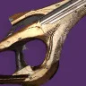
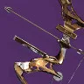
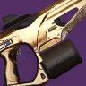
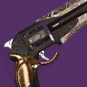
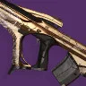
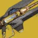

# 救赎花园

描述：救赎花园副本信息集合——图文攻略、首领生命值、DPS 门槛与关卡武器护甲掉落。
更新：2026.11.16
路径：raid-guides/garden-of-salvation
上级：Raid & 地牢
页脚：首领数值为固定难度下的实测值，不随光等浮动。
数据源：[Destiny 2: Boss Damage](https://docs.google.com/spreadsheets/u/0/d/1_5wtBjRYHHxuF4oJKDb_iOGZs-wTkzB6RYbnyNLbuz4/htmlview#gid=1346678363) 与 LFCarry 的 [Raid Loot Tables](https://lfcarry.com/guides/destiny-2-raid-loot-tables)
鸣谢：[遗忘Melt](https://space.bilibili.com/3706960595650983) 编写并维护图文攻略，小黑盒用户{buff|“压力一直天满光”}校对首领名称，蜃零#7456 整理{exotic|异域}武器与红框来源。
版式：副本
首屏图标：3

## 相关攻略

- [在腾讯文档查看「救赎花园」图文攻略](https://docs.qq.com/doc/DQ2pLUGx1bW5MQ0FS) | 图文攻略 · 腾讯文档 | 遗忘Melt 编写并维护

## 首领数值

色阶：生命值 170000 250155 290000 400000 500000 550000 868186

| 首领名称 | 生命值 | 距离 | 时间 | 击杀 DPS | 一波 DPS | 注解 |
|---|---|---|---|---|---|---|
|  崇圣首脑·太阳系固有 | 153455 | 近至中 | 20.733 | 411 | 1234 |  |
|  圣洁首脑·太阳系固有 | 196586 | 远 | 17.417 | 627 | 1881 | 打弱点下半部更稳定，{buff|神性}力场出现在脚下 |

## 关卡掉落

护甲套装：第三百夫长；{exotic|异域}武器：{exotic|神圣裁决}（解密获取，催化剂为世界掉落）；七把传说武器均可获取红框锻造。

| 关卡 | 武器掉落 | 护甲部位 |
|---|---|---|
| 第 1 关 · 躲避崇圣首脑 |  {el-void|虚空} · 狂徒的奖励（融合步枪）\\ {el-kinetic|动能} · 累积救赎（战斗弓箭） |    腿部 |
| 第 2 关 · 召唤崇圣首脑 |  {el-arc|电弧} · 末日先知（霰弹枪）\\ {el-void|虚空} · 鲁莽神谕（自动步枪） |    手臂 |
| 第 3 关 · 崇圣首脑·太阳系固有 |  {el-solar|烈日}/{el-void|虚空} · 上古福音（手炮）\\ {el-kinetic|动能} · 神圣起源（脉冲步枪） |    胸部 |
| 第 4 关 · 圣洁首脑·太阳系固有 |  {el-solar|烈日} · 全知之眼（狙击步枪） |    头部\\   职业物品 |
| 异域任务（Divine Fragmentation） |  {exotic|神圣裁决}（{el-arc|电弧} 追踪步枪） | 无 |
