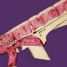
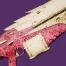
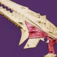
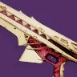
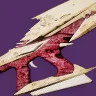
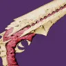
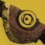

# 国王的陨落

描述：国王的陨落副本信息集合——图文攻略、首领生命值、DPS 门槛与关卡武器护甲掉落。
更新：2026.11.16
路径：raid-guides/kings-fall
上级：Raid & 地牢
页脚：首领数值为固定难度实测，不随光等浮动。
数据源：[Destiny 2: Boss Damage](https://docs.google.com/spreadsheets/u/0/d/1_5wtBjRYHHxuF4oJKDb_iOGZs-wTkzB6RYbnyNLbuz4/htmlview#gid=1346678363) 与 LFCarry 的 [Raid Loot Tables](https://lfcarry.com/guides/destiny-2-raid-loot-tables)
鸣谢：[遗忘Melt](https://space.bilibili.com/3706960595650983) 编写图文攻略，小黑盒用户{buff|“压力一直天满光”}校对首领名称，蜃零#7456 整理{exotic|异域}武器与红框来源
版式：副本
首屏图标：5

## 相关攻略

- [在腾讯文档查看「国王的陨落」图文攻略](https://docs.qq.com/doc/DQ2hTZkpKbVpuTEV5) | 图文攻略 · 腾讯文档 | 遗忘Melt 编写并维护

## 首领数值

色阶：生命值 170000 250155 290000 400000 500000 550000 868186

| 首领名称 | 生命值 | 距离 | 时间 | 击杀 DPS | 一波 DPS | 注解 |
|---|---|---|---|---|---|---|
|  战争祭祀 | 480831 | 近 | 45 | 594 | 4452 |  |
|  高尔格罗斯 | 409156 | 近至中 | 20 | 189 | 3410 | {buff|不稳定光能}造成 {amp|13501 伤害} |
|  姐妹们 | 167594 | 中 | {na|不定} |  |  |  |
|  邪神欧里克斯 | 423189 | 远 | 24.783 | 711 | 2846 | 演出{bar-yellow|首领}{note|（弹射物追踪与虚空箭不生效）} |

## 关卡掉落

护甲套装：欧里克斯记忆；{exotic|异域}武器：{exotic|恶意触碰}（尾王掉落，催化剂由解密获取）；六把传说武器均可获取红框锻造。

| 关卡 | 武器掉落 | 护甲部位 |
|---|---|---|
| 第 1 关 · 图腾 |  {el-void|虚空} · 切尔奇斯的末日（斥候步枪）\\ {el-stasis|冰影} · 库里姆的终界（机枪） |    职业物品\\   胸部\\   腿部 |
| 第 2 关 · 战争祭祀 |  {el-kinetic|动能} · 梅拉恩的惩戒（脉冲步枪）\\ {el-kinetic|动能} · 亚斯明的抗争（狙击步枪） |    手臂\\   胸部 |
| 第 3 关 · 高尔格罗斯 |  {el-stasis|冰影} · 库里姆的终界（机枪）\\ {el-arc|电弧} · 弥达的清算（融合步枪）\\ {el-solar|烈日} · 扎乌利的克星（手炮） |    头部\\   腿部 |
| 第 4 关 · 姐妹们 |  {el-kinetic|动能} · 梅拉恩的惩戒（脉冲步枪）\\ {el-kinetic|动能} · 亚斯明的抗争（狙击步枪）\\ {el-solar|烈日} · 扎乌利的克星（手炮） |    手臂\\   胸部 |
| 第 5 关 · 邪神欧里克斯 |  {exotic|恶意触碰}（{el-kinetic|动能} 斥候步枪）\\其余任意突袭武器 |    手臂\\   头部 |
