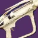
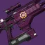
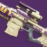
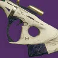
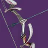

# 最后一愿

描述：最后一愿副本信息集合——图文攻略、首领生命值、DPS 门槛与关卡武器护甲掉落。
更新：2026.11.16
路径：raid-guides/last-wish
上级：Raid & 地牢
页脚：首领数值为固定难度实测，不随光等浮动；击杀 / 一波 DPS 为满编人均门槛（突袭 6 人、地牢 3 人）。
数据源：[Destiny 2: Boss Damage](https://docs.google.com/spreadsheets/u/0/d/1_5wtBjRYHHxuF4oJKDb_iOGZs-wTkzB6RYbnyNLbuz4/htmlview#gid=1346678363) 与 LFCarry 的 [Raid Loot Tables](https://lfcarry.com/guides/destiny-2-raid-loot-tables)
鸣谢：[遗忘Melt](https://space.bilibili.com/3706960595650983) 编写图文攻略，小黑盒用户{buff|“压力一直天满光”}校对首领名称，蜃零#7456 整理{exotic|异域}武器与红框来源
版式：副本
首屏图标：5

## 相关攻略

- [在腾讯文档查看「最后一愿」图文攻略](https://docs.qq.com/doc/DQ1hoQXpSTU5MVVFE) | 图文攻略 · 腾讯文档 | 遗忘Melt 编写并维护

## 首领数值

色阶：生命值 170000 250155 290000 400000 500000 550000 868186

| 首领名称 | 生命值 | 距离 | 时间（秒） | 击杀 DPS | 一波 DPS | 注解 |
|---|---|---|---|---|---|---|
|  被腐化的卡丽 | 299440 | 近 | 72 | 116 | 347 | {amp|头部判定框受到 2 倍直击伤害} |
|  被腐化的秋露·知 | 253511 | 近至中 | 12.883 | 273 | 273 | {amp|头部判定框受到 2 倍直击伤害} |
|  守塔人摩格斯 | 125126 | 近 | 30 | 232 | 695 | {res|睡者之吼 40% 减伤、狙击步枪 45% 减伤、霰弹枪 55% 减伤} |
|  千语魅痕 | 170255 | 近 | 14.95 | {na|—} | 1898 | {res|睡者之吼 40% 减伤、狙击步枪 45% 减伤、霰弹枪 55% 减伤}、面部判定框的 2 倍伤害{note|只是显示效果} |

## 关卡掉落

护甲套装：伟大狩猎；{exotic|异域}武器：{exotic|千语}（尾王开启终局宝箱抽取）；八把传说武器均可获取红框锻造。

| 关卡 | 武器掉落 | 护甲部位 |
|---|---|---|
| 全部关卡 |  {el-void|虚空} · 旧日羁绊（自动步枪）\\ {el-solar|烈日} · 巅峰捕食者（火箭发射器）\\ {el-kinetic|动能} · 唠叨龙骨（脉冲步枪）\\ {el-arc|电弧} · 野兽国度（手炮）\\ {el-arc|电弧} · 灵巫力量（融合步枪）\\ {el-kinetic|动能} · 霸权（狙击步枪）\\ {el-kinetic|动能} · 变形术（斥候步枪）\\ {el-solar|烈日} · 天堂暴政（战斗弓箭） |      任意部位 |
| 尾王 · 千语魅痕（终局宝箱） |  {exotic|千语}（{el-solar|烈日} 融合步枪）\\其余任意突袭武器 |      任意部位 |
