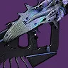
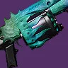
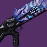
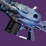
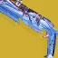

# 梦魇根源

描述：梦魇根源副本信息集合——图文攻略、首领生命值、DPS 门槛与关卡武器护甲掉落。
更新：2026.11.16
路径：raid-guides/root-of-nightmares
上级：Raid & 地牢
页脚：首领数值为固定难度实测，不随光等浮动。
数据源：[Destiny 2: Boss Damage](https://docs.google.com/spreadsheets/u/0/d/1_5wtBjRYHHxuF4oJKDb_iOGZs-wTkzB6RYbnyNLbuz4/htmlview#gid=1346678363) 与 LFCarry 的 [Raid Loot Tables](https://lfcarry.com/guides/destiny-2-raid-loot-tables)
鸣谢：[遗忘Melt](https://space.bilibili.com/3706960595650983) 编写图文攻略，小黑盒用户{buff|“压力一直天满光”}校对首领名称，蜃零#7456 整理{exotic|异域}武器与红框来源
版式：副本
首屏图标：3

## 相关攻略

- [在腾讯文档查看「梦魇根源」图文攻略](https://docs.qq.com/doc/DQ0RORUpxRWJ3SmFG) | 图文攻略 · 腾讯文档 | 遗忘Melt 编写并维护

## 首领数值

色阶：生命值 170000 250155 290000 400000 500000 550000 868186

| 首领名称 | 生命值 | 距离 | 时间 | 击杀 DPS | 一波 DPS | 注解 |
|---|---|---|---|---|---|---|
|  星球阐释者·泽乌尔克 | 295535 | 近至中 | 10 | 547 | 4926 |  |
|  终极苦痛之神·奈扎雷克 | 262082 | 近 | 30 | 485 | 1456 |  |

## 关卡掉落

护甲套装：奈扎雷克的梦魇；{exotic|异域}武器：{exotic|条件终局}（尾王掉落，催化剂由大师难度掉落）；六把传说武器均可获取红框锻造。

| 关卡 | 武器掉落 | 护甲部位 |
|---|---|---|
| 第 1 关（Cataclysm） |  {el-solar|烈日} · 蔷薇的蔑视（线性融合步枪）\\ {el-strand|缚丝} · 科拉西斯的苦恼（榴弹发射器）\\ {el-void|虚空} · 内萨的奉献（霰弹枪） |    胸部\\   手臂\\   头部 |
| 第 2 关（Scission） |  {el-strand|缚丝} · 麦克尔的崇敬（手枪）\\ {el-strand|缚丝} · 科拉西斯的苦恼（榴弹发射器）\\ {el-solar|烈日} · 阿卡西娅的沮丧（追踪步枪）\\ {el-void|虚空} · 内萨的奉献（霰弹枪） |    胸部\\   手臂\\   腿部 |
| 第 3 关 · 星球阐释者·泽乌尔克 |  {el-strand|缚丝} · 麦克尔的崇敬（手枪）\\ {el-strand|缚丝} · 鲁弗斯的狂怒（自动步枪）\\ {el-solar|烈日} · 阿卡西娅的沮丧（追踪步枪）\\ {el-strand|缚丝} · 科拉西斯的苦恼（榴弹发射器） |    胸部\\   职业物品\\   腿部 |
| 第 4 关 · 终极苦痛之神·奈扎雷克 |  {exotic|条件终局}（{el-stasis|冰影}/{el-solar|烈日} 霰弹枪）\\其余任意突袭武器 |    头部\\   腿部\\   职业物品 |
