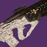
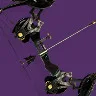
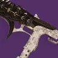
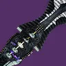
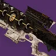
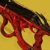

# 救赎的边缘

描述：救赎的边缘副本信息集合——图文攻略、首领生命值、DPS 门槛与关卡武器护甲掉落。
更新：2026.11.16
路径：raid-guides/salvations-edge
上级：Raid & 地牢
页脚：首领数值为固定难度下的实测值，不随光等浮动。
数据源：[Destiny 2: Boss Damage](https://docs.google.com/spreadsheets/u/0/d/1_5wtBjRYHHxuF4oJKDb_iOGZs-wTkzB6RYbnyNLbuz4/htmlview#gid=1346678363) 与 LFCarry 的 [Raid Loot Tables](https://lfcarry.com/guides/destiny-2-raid-loot-tables)
鸣谢：[遗忘Melt](https://space.bilibili.com/3706960595650983) 编写并维护图文攻略，小黑盒用户{buff|“压力一直天满光”}校对首领名称，蜃零#7456 整理{exotic|异域}武器与红框来源。
版式：副本
首屏图标：3

## 相关攻略

- [在腾讯文档查看「救赎的边缘」图文攻略](https://docs.qq.com/doc/DQ21GY3BIV3ZJa1hz) | 图文攻略 · 腾讯文档 | 遗忘Melt 编写并维护

## 首领数值

色阶：生命值 170000 250155 290000 400000 500000 550000 868186

| 首领名称 | 生命值 | 距离 | 时间 | 击杀 DPS | 一波 DPS | 注解 |
|---|---|---|---|---|---|---|
|  终局使者 | 391079 | 近至中 | 30 | 724 | 2173 |  |
|  见证者 | 543552 | 远 | 45 | 671 | 2013 | 演出{bar-yellow|首领}{note|（弹射物追踪与虚空箭不生效）} |

## 关卡掉落

护甲套装：应许之物；{exotic|异域}武器：{exotic|悦耳之声}（尾王掉落，催化剂由大师难度掉落）；六把传说武器均可获取红框锻造。

| 关卡 | 武器掉落 | 护甲部位 |
|---|---|---|
| 第 1 关（Substratum） |  {el-solar|烈日} · 作废（脉冲步枪）\\ {el-arc|电弧} · 终焉未至（战斗弓箭）\\ {el-strand|缚丝} · 迫近（微型冲锋枪） |    手臂\\   胸部 |
| 第 2 关 · 终局使者 |  {el-arc|电弧} · 至善（刀剑）\\ {el-arc|电弧} · 终焉未至（战斗弓箭）\\ {el-void|虚空} · 偏异将临（偃月）\\ {el-strand|缚丝} · 迫近（微型冲锋枪） |    头部\\   职业物品 |
| 第 3 关（Repository） |  {el-solar|烈日} · 作废（脉冲步枪）\\ {el-stasis|冰影} · 临界异常（狙击步枪）\\ {el-void|虚空} · 偏异将临（偃月） |    手臂 |
| 第 4 关（Verity） |  {el-arc|电弧} · 至善（刀剑）\\ {el-arc|电弧} · 终焉未至（战斗弓箭）\\ {el-strand|缚丝} · 迫近（微型冲锋枪） |    腿部 |
| 第 5 关 · 见证者 |  {exotic|悦耳之声}（{el-strand|缚丝} 线性融合步枪）\\ {el-arc|电弧} · 至善（刀剑）\\ {el-solar|烈日} · 作废（脉冲步枪）\\ {el-stasis|冰影} · 临界异常（狙击步枪） |    头部\\   腿部 |
