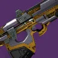
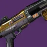
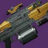
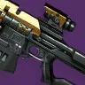
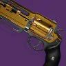
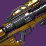
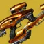

# 玻璃拱顶

描述：玻璃拱顶副本信息集合——图文攻略、首领生命值、DPS 门槛与关卡武器护甲掉落。
更新：2026.11.16
路径：raid-guides/vault-of-glass
上级：Raid & 地牢
页脚：首领数值为固定难度实测，不随光等浮动；击杀 / 一波 DPS 为满编人均门槛（突袭 6 人、地牢 3 人）。
数据源：[Destiny 2: Boss Damage](https://docs.google.com/spreadsheets/u/0/d/1_5wtBjRYHHxuF4oJKDb_iOGZs-wTkzB6RYbnyNLbuz4/htmlview#gid=1346678363) 与 LFCarry 的 [Raid Loot Tables](https://lfcarry.com/guides/destiny-2-raid-loot-tables)
鸣谢：[遗忘Melt](https://space.bilibili.com/3706960595650983) 编写图文攻略，小黑盒用户{buff|“压力一直天满光”}校对首领名称，蜃零#7456 整理{exotic|异域}武器与红框来源
版式：副本
首屏图标：3

## 相关攻略

- [在腾讯文档查看「玻璃拱顶」图文攻略](https://docs.qq.com/doc/DQ2VhRXFrZ3pxZkNj) | 图文攻略 · 腾讯文档 | 遗忘Melt 编写并维护

## 首领数值

色阶：生命值 170000 250155 290000 400000 500000 550000 868186

| 首领名称 | 生命值 | 距离 | 时间（秒） | 击杀 DPS | 一波 DPS | 注解 |
|---|---|---|---|---|---|---|
|  圣堂武士 | 182640 | 近至中 | 15 | {na|—} | 2029 | {res|非升起状态下受到的爆炸伤害降低}{note|（否定仪式）} |
|  时之汇流·埃希恩 | 247148 | 近 | 30 | 92 | 275 | {amp|当前受到 5 倍伤害}{note|（手雷伤害为 3 倍）} |

## 关卡掉落

护甲套装：埃希恩记忆；{exotic|异域}武器：{exotic|Vex 揭秘者}（尾王掉落，催化剂由解密获取）；六把传说武器均可获取红框锻造。

| 关卡 | 武器掉落 | 护甲部位 |
|---|---|---|
| 第 1 关 · 汇流 |  {el-solar|烈日} · 汇流愿景（斥候步枪）\\ {el-arc|电弧} · 裁决定论（霰弹枪）\\ {el-void|虚空} · 惩戒措施（机枪） |    手臂\\   职业物品 |
| 第 2 关 · 神谕 |  {el-kinetic|动能} · 普莱蒂斯的复仇（狙击步枪）\\ {el-solar|烈日} · 汇流愿景（斥候步枪）\\ {el-arc|电弧} · 裁决定论（霰弹枪） |    手臂\\   腿部 |
| 第 3 关 · 圣堂武士 |  {el-kinetic|动能} · 命运终结者（手炮）\\ {el-solar|烈日} · 汇流愿景（斥候步枪）\\ {el-void|虚空} · 惩戒措施（机枪） |    手臂\\   胸部 |
| 第 4 关 · 守门人 |  {el-kinetic|动能} · 命运终结者（手炮）\\ {el-solar|烈日} · 光芒复仇（火箭发射器）\\ {el-arc|电弧} · 裁决定论（霰弹枪） |    头部\\   腿部 |
| 第 5 关 · 时之汇流·埃希恩 |  {exotic|Vex 揭秘者}（{el-solar|烈日} 融合步枪）\\ {el-kinetic|动能} · 普莱蒂斯的复仇（狙击步枪）\\ {el-void|虚空} · 惩戒措施（机枪）\\ {el-solar|烈日} · 光芒复仇（火箭发射器） |    头部\\   胸部 |
