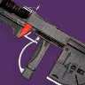
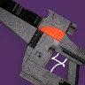
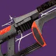
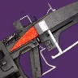
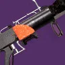
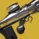
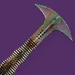

# 门徒誓约

描述：门徒誓约副本信息集合——图文攻略、首领生命值、DPS 门槛与关卡武器护甲掉落。
更新：2026.11.16
路径：raid-guides/vow-of-the-disciple
上级：Raid & 地牢
页脚：首领数值为固定难度下的实测值，不随光等浮动。
数据源：[Destiny 2: Boss Damage](https://docs.google.com/spreadsheets/u/0/d/1_5wtBjRYHHxuF4oJKDb_iOGZs-wTkzB6RYbnyNLbuz4/htmlview#gid=1346678363) 与 LFCarry 的 [Raid Loot Tables](https://lfcarry.com/guides/destiny-2-raid-loot-tables)
鸣谢：[遗忘Melt](https://space.bilibili.com/3706960595650983) 编写并维护图文攻略，小黑盒用户{buff|“压力一直天满光”}校对首领名称，蜃零#7456 整理{exotic|异域}武器与红框来源。
版式：副本
首屏图标：3

## 相关攻略

- [在腾讯文档查看「门徒誓约」图文攻略](https://docs.qq.com/doc/DQ01qTUVKWVp6UEVO) | 图文攻略 · 腾讯文档 | 遗忘Melt 编写并维护

## 首领数值

色阶：生命值 170000 250155 290000 400000 500000 550000 868186

| 首领名称 | 生命值 | 距离 | 时间 | 击杀 DPS | 一波 DPS | 注解 |
|---|---|---|---|---|---|---|
|  看护人 | 663786 | 近 | 7.5 | 697 | 6269 | 站在板上{amp|造成 2 倍伤害}、超过阈值后的 25% 增伤{note|是「虚假」增伤} |
|  见证者门徒·胡克 | 397638 | 中 | 36 | 614 | 1841 | 弱点爆炸{note|只是视觉效果} |

## 关卡掉落

护甲套装：共振狂怒；{exotic|异域}武器：{exotic|集体义务}（尾王掉落）；六把传说武器均可获取红框锻造。

| 关卡 | 武器掉落 | 护甲部位 |
|---|---|---|
| 第 1 关（Acquisition） |  {el-kinetic|动能} · 驯顺（微型冲锋枪）\\ {el-stasis|冰影} · 解脱（融合步枪）\\ {el-solar|烈日} · 灾变（线性融合步枪） |    头部\\   胸部\\   腿部 |
| 第 2 关 · 看护人 |  {el-kinetic|动能} · 驯顺（微型冲锋枪）\\ {el-arc|电弧} · 阴险（脉冲步枪）\\ {el-solar|烈日} · 灾变（线性融合步枪）\\ {el-arc|电弧} · 自制（榴弹发射器） |    头部\\   手臂\\   职业物品 |
| 第 3 关（Exhibition） |  {el-kinetic|动能} · 驯顺（微型冲锋枪）\\ {el-stasis|冰影} · 解脱（融合步枪） |    胸部\\   腿部 |
| 第 4 关 · 见证者门徒·胡克 |  {exotic|集体义务}（{el-void|虚空} 脉冲步枪）\\ {el-arc|电弧} · 阴险（脉冲步枪）\\ {el-solar|烈日} · 鲁布瑞之厄（偃月）\\ {el-arc|电弧} · 自制（榴弹发射器） |    头部\\   手臂\\   职业物品 |
